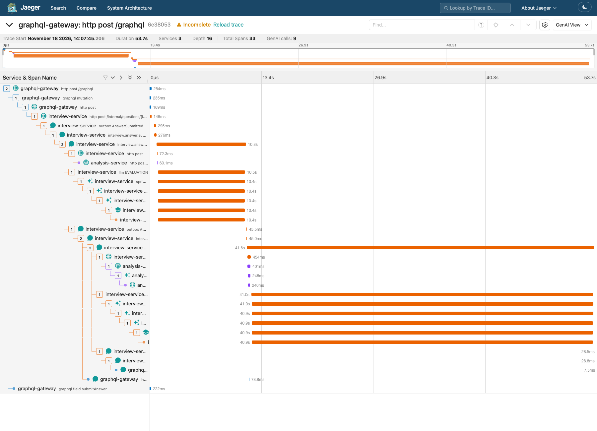

# Results (measured, not estimated)

Every number on the resume comes from this file. Fill it in as tasks are completed. Include the date, the commit, and how each number was measured.

## Analysis performance (task 1.15)

| Repo | Files | Chunks | Clone | Parse | Embed | Summarize | Total | Date / commit |
|---|---|---|---|---|---|---|---|---|
| shopping-cart-spring-security @ `0d2ffc0` | 400 (355 Java, 33 139 lines) | 2 102 | 2.1 s | 4.8 s | 132.0 s | 20.0 s | 159.0 s | 2026-10-31 / `39f98ec` |

Measured from the app log (stage start/end lines, `Analysis READY in 159031 ms`), dev environment on an Apple-silicon Mac, Ollama native. Embedding is 83% of the total: 66 batches of 32 at about 2.0 s each. The clone was 2.1 MB.

## Interview latency and cost (tasks 1.15, 1.16, 4.5)

| Setup | p50 next question | p95 next question | Input tokens / session | Output tokens / session | Cached tokens | Date / commit |
|---|---|---|---|---|---|---|
| Phase 1, no prefetch | 34.9 s | 41.5 s | 120 873 | 21 731 | — | 2026-10-31 / `39f98ec` |
| Phase 1, prefetch | 18.1 s | 26.8 s | 95 024 | 20 414 | — | 2026-10-31 / `36ddfce` + task 1.16 |
| Phase 4, prompt caching | — (not measured: only PLAN is cached, see below) | — | PLAN 494 uncached + 21 350 cached | — | 21 350 per repeated PLAN | 2026-11-19 / task 4.5 |

Useful query:

```sql
SELECT purpose, model, count(*) AS calls,
       percentile_cont(0.5) WITHIN GROUP (ORDER BY latency_ms) AS p50_ms,
       percentile_cont(0.95) WITHIN GROUP (ORDER BY latency_ms) AS p95_ms,
       sum(input_tokens) AS input_tokens, sum(output_tokens) AS output_tokens,
       avg(CASE WHEN success THEN 1 ELSE 0 END) AS success_rate
FROM llm_call
WHERE created_at > now() - interval '1 day'
GROUP BY purpose, model
ORDER BY purpose;
```

How the Phase 1 row was measured (task 1.15, one JUNIOR interview, 5 topics, 6 questions):
- **Next question** = time from sending an answer to getting the next question: grading plus generating the question. n = 5: 25.1, 28.2, 34.9, 35.6 and about 43 s (the last one includes a retry after the output cap; the client got a 503 at 30 s, see problem 2). p95 by `percentile_cont`, so with n = 5 it is close to the slowest run.
- **First question** (`startInterview`: plan + question) took 29 s. The report after the last answer took 34.4 s (grading + report).
- **Tokens per session**: the 17 calls with this `session_id` (summary not included), 3 failed calls included. The failed calls (problem 1) used 17 645 input and 3 900 output tokens: 15% and 18% of the session.

How the prefetch row was measured (task 1.16, same repo and commit, no re-analysis, one JUNIOR interview, 4 topics, 7 questions, answers pasted by Aryan after at least 20 s per question):
- **Next question** = `answer.submitted_at` → next question's `asked_at` (client times matched within 0.3 s). n = 6, three of each kind:
  - **Main question, prefetched**: 15.9, 17.2 and 13.8 s, p50 15.9 s, p95 17.1 s. Each equals its grading time (15.8, 16.7, 13.8 s): the question was already `PREPARED`, so only the grade was waited for. Every prefetch was saved 15–26 s after the previous main question was asked (19.4, 14.9, 26.3 s), minutes before the answer it was waiting for.
  - **Follow-up** (score 4, 7, 4: a follow-up cannot be prefetched, it depends on the answer): 19.0, 25.5 and 27.2 s, p50 25.5 s, p95 27.1 s, grading plus FOLLOW_UP.
  - The mix matters: 1.15 had one follow-up in five steps, this run three in six. Both runs are n ≤ 6.
- **Calls**: 16, none failed. QUESTION 4 = 1 in `startInterview` + 3 prefetched, none wasted (no `PREPARED` question left unused). EVALUATION 7, FOLLOW_UP 3, PLAN 1, REPORT 1. Latency per call like 1.15 (EVALUATION p50 14.2 s, QUESTION 18.3 s, FOLLOW_UP 8.8 s), largest output 1 942 tokens (QUESTION), below every cap.
- **What is left**: the HLD target (p95 < 12 s; < 6 s) needs grading out of the request: async evaluation, task 2.5. The report after the last answer took 29.4 s (grading + report).

Per call (`llm_call` for this project, same day):

| Purpose | Model | Calls | Failed | p50 | p95 | Max output tokens | Input tokens | Output tokens |
|---|---|---|---|---|---|---|---|---|
| SUMMARY | claude-haiku-4-5 | 1 | 0 | 19.8 s | 19.8 s | 1 430 | 17 301 | 1 430 |
| PLAN | claude-sonnet-5 | 1 | 0 | 14.2 s | 14.2 s | 1 425 | 21 797 | 1 425 |
| QUESTION | claude-sonnet-5 | 6 | 1 | 17.2 s | 21.0 s | 2 060 | 61 620 | 9 233 |
| EVALUATION | claude-sonnet-5 | 8 | 2 | 14.0 s | 16.3 s | 1 571 | 31 144 | 9 247 |
| FOLLOW_UP | claude-sonnet-5 | 1 | 0 | 8.9 s | 8.9 s | 751 | 2 957 | 751 |
| REPORT | claude-haiku-4-5 | 1 | 0 | 16.9 s | 16.9 s | 1 075 | 3 355 | 1 075 |

### Problems found in the first real run (2026-10-31)
1. **Output caps too low for Sonnet 5.** Three calls stopped exactly at their cap and returned cut-off JSON (`output_invalid`): one QUESTION at 1 500 and two EVALUATIONs at 1 200 (both attempts, so `submitAnswer` returned `LLM_UNAVAILABLE`). With the caps raised to 3 000 (command-line override for the rest of the run), the largest outputs were QUESTION 2 060 and EVALUATION 1 571. PLAN (1 425 of 2 000) and SUMMARY (1 430 of 2 000) are also close.
2. **`submitAnswer` is longer than the 30 s request limit.** Grading plus the next question took 25–43 s. Tomcat's default async timeout is 30 s, so the client got HTTP 503 while the server finished the work. Re-sending the same answer returned the stored result in 0.3 s with no new model call (the resume path from task 1.11). `spring.mvc.async.request-timeout=120s` fixed it: a 35.6 s request then returned normally. Prefetch (1.16) and async evaluation (2.5) are the real fixes.
3. **Code refs with no snippet** (fixed 2026-11-01: snippets now come from the stored, redacted file, `V2__code_file_content.sql`; projects analyzed before that keep the old chunk-based snippets). `CodeRef.snippet` is null when the cited lines are only in a `TYPE_HEADER` chunk, because `ChunkStore.snippets` skips header chunks (their text is an outline, not the exact lines). 57 of the 355 Java files have only a header chunk (34 DTO, 18 OTHER, 5 CONFIG), and class annotations and fields of every other class live only in headers too. Two of six questions had a ref with no snippet (Q1 `ModuleConfiguration.java:31-38`, Q4 `Cart.java:16-26`), and Q5's 234-line ref left out the `@Table` constraint and `updatable = false` fields the question was about.

## Question quality (tasks 1.17, 5.1)

| Repo | Grounding rate | Specificity | Duplicate rate | Grader consistency | Injection ≤ 2 | Empty ≤ 1 | Ideal answer ≥ 8 | Date / prompt versions |
|---|---|---|---|---|---|---|---|---|
| e-commerce @ `0d2ffc0` | 8/8 (100%) | 8/8 (100%) | 0/24 (0%) | 4/4 (100%) | 4/4 (100%) | 4/4 (100%) | 3/4 (75%) | 2026-11-01 / interview-plan@29019fc8, question-generation@c6778cfe, follow-up-question@5dd42920, answer-evaluation@b0969903 |

How the 1.17 row was measured (`./mvnw verify -Pevals -Dtest=QuestionQualityEvalTest`, 635 s, metric definitions in LLD §12): the repo analyzed from scratch (270 s; embedding 243 s against 132 s in 1.15 for the same 2 102 chunks, Ollama sharing the laptop with the test database), one JUNIOR interview with 5 topics requested and 4 planned (all 4 got a question), every answer the first half of the question's own ideal outline, then four more grades per main question.

| Q | Kind | Shows code | Names a symbol | Half | Half again | Whole outline | Injection | "I don't know." |
|---|---|---|---|---|---|---|---|---|
| 1 | ARCHITECTURE | yes | yes | 4 | 3 | **7** | 0 | 0 |
| 2 | follow-up | yes | yes | 7 | — | — | — | — |
| 3 | DATA_MODEL | yes | yes | 5 | 6 | 9 | 0 | 0 |
| 4 | follow-up | yes | yes | 5 | — | — | — | — |
| 5 | FAILURE_HANDLING | yes | yes | 6 | 6 | 9 | 0 | 0 |
| 6 | follow-up | yes | yes | 6 | — | — | — | — |
| 7 | SECURITY | yes | yes | 5 | 5 | 9 | 0 | 0 |
| 8 | follow-up | yes | yes | 7 | — | — | — | — |

Findings:
1. **Every HLD target met except one**: Q1's own ideal outline, used as the answer, scored 7 (target ≥ 8). One miss in four; not enough to change a prompt. Watch it on the four repos of task 5.1. The grader was consistent on the middling answers (largest gap 1 point), and gave 0 to every injection and every "I don't know."
2. **Header-only refs (problem 3 of 1.15) did not appear**: all 8 questions had a ref that shows code, against 2 of 6 in 1.15. With n = 8 this is luck, not a fix; the grounding metric now catches it when it comes back.
3. **Every main question got a follow-up**: half-outline answers scored 4–6, inside the 3–7 follow-up range, as designed. So 8 questions (4 follow-ups) from 4 topics.
4. **QUESTION output is close to its cap**: the largest reply was 3 276 tokens of a 4 000 cap, 1.2×, below the "at least 2× the largest output" rule from the 1.15 fix (largest then: 2 060). A reply cut off at the cap is unreadable JSON. Raised to 7 000 right after this run (Status log, 2026-11-01).
5. **Calls**: 35, none failed: EVALUATION 24 (p50 6.6 s; the short adversarial answers grade fast), QUESTION 4 (p50 27.1 s), FOLLOW_UP 4, PLAN, SUMMARY and REPORT 1 each. 174 721 input and 32 181 output tokens, about $0.65.

Prompt changes because of this run: none.

## Notes from real interviews (task 1.15)

1. **Good question** (Q6, FAILURE_HANDLING): "two deliveries of the same webhook event id arrive at almost the same instant and both pass the `events.existsByEventId` check ... where does the duplicate actually get caught, and why is `events.saveAndFlush(...)` placed before the recorder calls?" It cites the three places that answer it (`PaymentWebhookProcessor.process`, the `DataIntegrityViolationException` catch in `PaymentWebhookService.receive`, and the unique key in `V14__payment_webhook_events.sql`), every snippet came through, and it can only be answered by reasoning about this code. Q2 (refresh-token reuse in `RefreshTokenService.rotate`) was grounded the same way.
2. **Weak question** (Q4, CONCURRENCY): it asks what the `@Version` field on `Cart` still does, but cites `Cart.java:16-26` (class annotations and `id`), while `@Version` is on lines 28-29, and that ref had no snippet (problem 3). Q5 had the same issue with a 234-line ref. Q1 asked two questions in one (why separate Maven modules, and what the `@ModuleConfiguration` annotations do) and cited `pom.xml:35-94`, which is mostly CVE version comments. **Prompt change: none yet.** The ref problems come from code (header chunks and ref ranges), not from the prompt, so they are fixed in code first.
3. **Grader**: mostly grounded and fair. Its "refetch and retry" recovery for the optimistic-lock question matches the repo's `GlobalExceptionHandler` (409 with that exact advice), which was not among the cited refs. Small mistakes: an ideal outline said `@ModuleConfiguration` "excludes TypeExcludeFilter" (it uses that filter to decide exclusions); it called "token family" an invented idea although the code's Javadoc says "the family revocation must commit"; and it named a boolean `repeated=true` that the code does not name.

The full transcript (questions, answers, grades, report) is kept private for now, outside the repository.

## Autoscaling with KEDA (task 3.4, 2026-11-05)

Local kind cluster (one node, Docker's VM: 8 vCPU, 3.8 GiB), KEDA 2.21.0, the workers scaled on Kafka consumer lag (`lagThreshold` 2, min 1, max 2 locally, scale-down after 60 s). Load from `loadtest/interviews.js` (k6) through `kubectl port-forward`, against the real model: 7 interview sessions on `spring-petclinic` (3 questions, all first answers sent at the same moment) and 6 small `spring-guides/gs-*` repositories submitted at once. Replicas logged every 5 s by `loadtest/sample-scaling.sh`; the lines where something changed:

```
time      interview-worker(lag desired ready)   analysis-worker(lag desired ready)
11:59:31   interview-worker lag=0 desired=1 ready=1   analysis-worker lag=0,0 desired=1 ready=1
11:59:43   interview-worker lag=0 desired=1 ready=1   analysis-worker lag=0,6 desired=2 ready=1   <- 6 repos to ingest
12:01:49   interview-worker lag=5 desired=2 ready=1   analysis-worker lag=0,0 desired=2 ready=1   <- 5 answers to grade
12:01:55   interview-worker lag=5 desired=2 ready=1   analysis-worker lag=0,0 desired=2 ready=2
12:02:31   interview-worker lag=2500m desired=2 ready=1   analysis-worker lag=0,0 desired=1 ready=2
12:02:51   interview-worker lag=2500m desired=2 ready=1   analysis-worker lag=0,0 desired=1 ready=1   <- back to 1
12:05:31   interview-worker lag=0 desired=1 ready=1   analysis-worker lag=0,0 desired=1 ready=1   <- back to 1
12:08:27   interview-worker lag=0 desired=1 ready=1   analysis-worker lag=0,0 desired=1 ready=1
```
`lag` is the HPA's metric per pod (for analysis-worker: embed, ingest); `2500m` = 2.5 (5 answers over the 2 pods it wants).

- **analysis-worker:** 1 → 2 → 1. Six ingest events made it want 2; the second pod was Ready after about 2 minutes (the node was swapping), and 60 s after the lag was gone it went back to 1.
- **interview-worker:** the HPA wanted 2 as soon as 5 answers waited and went back to 1 when they were graded, but its second pod never got Ready: with five app JVMs, KEDA, Kafka and Postgres, the VM had 93 MB free and 433 MB in swap, and that pod was still booting when the first one had graded the lot. On this laptop the scaling decision works and the capacity does not.
- k6: 375 requests, none failed; 6 of 6 analyses READY; 5 of 7 interviews started and 4 of those completed (below).
- Model calls: 45, all successful (EVALUATION 14, PLAN 7, QUESTION 14 on Sonnet; REPORT 4, SUMMARY 6 on Haiku), 234k input and 33k output tokens on Sonnet, about $0.85.

Found on the way:
1. **2 of 7 plans rejected.** "Could not plan questions grounded in this repository's code": the PLAN reply failed `TopicValidator` and the session ended in PLANNING. The same repository planned fine in task 3.3; one rejected plan ends a session with no retry.
2. **A transient failure of Ollama ended a session.** Under the load, a pod could not resolve `host.docker.internal` for one embedding call (the orchestrator's retrieval for the next question). `ResourceAccessException` is not retryable (DECISIONS.md D-019), so the event went to the dead-letter topic and the session FAILED ("The interview could not continue"). Embedding errors should be retried like an unavailable model.
3. **KEDA could not read the lag for short spells**: Kafka answered "consumer group not coordinated by this broker" while groups rebalanced and while the node was overloaded; the HPA kept its last decision meanwhile.

## One answer, traced across the three services (task 4.3, 2026-11-18)

Acceptance criterion of task 4.3: one trace covering a full `submitAnswer`. The three apps in dev with Kafka (`dev,kafka`, commit `d74e90e`), Compose Postgres and Kafka, Jaeger, Prometheus and Grafana (`docker compose --profile kafka --profile observability up -d`), Ollama on the Mac, the real Claude models. The eval repository (`aryankanani1/shopping-cart-spring-security`) analyzed first (READY in about 5 minutes, one SUMMARY call), then an interview of 3 questions started (38 s: PLAN, then the first question) and one answer sent with a W3C `traceparent` of our own, so the trace could be found by its id.



One trace, 33 spans, 3 services, 53.7 s from the request to the gateway forwarding the next question (Jaeger marks it "Incomplete" because its root's parent is the `traceparent` sent by `curl`, which recorded no span):

| From the start of `submitAnswer` | Span | Took |
|---|---|---|
| 0.00 s | graphql-gateway `http post /graphql` (the request: the answer is saved and AnswerSubmitted written) | 0.25 s |
| 0.09 s | interview-service `http post /internal/questions/{id}/answer` | 0.15 s |
| 0.56 s | interview-service `outbox AnswerSubmitted` (the relay's next poll, then the send) | 0.30 s |
| 0.87 s | interview-service `interview.answer.submitted process` (the evaluation worker) | 10.75 s |
| 0.92 s | analysis-service `http post /internal/projects/{id}/chunks/ranges` (the code to grade against) | 0.06 s |
| 1.00 s | interview-service `llm EVALUATION` | 10.45 s |
| 11.65 s | interview-service `outbox AnswerEvaluated` | 0.05 s |
| 11.71 s | interview-service `interview.answer.evaluated process` (the orchestrator) | 41.62 s |
| 11.78 s | analysis-service `http post /internal/projects/{id}/chunks/search` (with a 0.25 s Ollama embedding) | 0.40 s |
| 11.94 s | graphql-gateway `interview.answer.evaluated process` (the grade to the subscription) | 0.08 s |
| 12.27 s | interview-service `llm QUESTION` | 40.97 s |
| 53.65 s | interview-service `outbox QuestionReady` | 0.03 s |
| 53.70 s | graphql-gateway `interview.question.ready process` (the next question to the subscription) | 0.01 s |

What it shows:
- **The model is the time.** Of 53.7 s, 51.4 s are the two model calls; everything the services do around them (HTTP between them, the outbox, Kafka, the code lookups, the embedding) adds up to about 2.3 s, and the slowest single piece is the outbox's wait for its next poll (up to 500 ms).
- **A prefetch race made the candidate wait 40 s for nothing.** The next question (topic 2) was being prefetched since the first question was asked, and was saved 2 s after the orchestrator, finding none, had started its own QUESTION call. When that call ended 41 s later, the orchestrator found the prefetched question and asked it (as LLD §9.4 says: "the second waits for the first and uses its question"), so its own call was wasted. Correct, but while the grade reached the gateway after 11.9 s, the next question came after 53.7 s instead of about 14 s (when the prefetched one was saved). A follow-up: when a prefetch for the topic is running, wait for it instead of generating a second question.
- The prefetch itself runs on its own executor, so its QUESTION call is a trace of its own, not part of this one (DECISIONS.md D-028).

Model calls of this session (`interview.llm_call`): PLAN 12.0 s, QUESTION 19.7 s (first question), EVALUATION 10.5 s, QUESTION 24.6 s (the prefetch of question 2), QUESTION 41.0 s (the wasted one), QUESTION 21.1 s (the prefetch of question 3), all successful; 57.9k input and 11.6k output tokens on Sonnet, about $0.23 at $2 / $10 per MTok. Plus the analysis's SUMMARY on Haiku (17.3k input, 1.3k output tokens).

The screenshot was taken with headless Chrome from Jaeger's trace page (`--screenshot`, 1800 × 1300), so it shows span names and timings only: no prompt, answer or score.

## Prompt caching (task 4.5, 2026-11-19)

Acceptance criterion of task 4.5: input-token cost and latency per session, before and after. Only PLAN carries a block worth caching (DECISIONS.md D-032), so the measurement is the start of an interview (PLAN, then the first question), four times on the same analyzed project (`aryankanani1/shopping-cart-spring-security`, 3 questions, prefetch off so each start makes exactly these calls): two with `app.llm.prompt-caching=false`, then two with it on, back to back. Prices: Sonnet 5 input $2/MTok, cache write $2.50 (1.25x), cache read $0.20 (0.1x), output $10.

| Start | PLAN input (uncached) | PLAN cache write | PLAN cache read | PLAN input cost | PLAN latency | Start total (input + output, all calls) | Client time |
|---|---:|---:|---:|---:|---:|---:|---:|
| off-1 | 21 844 + re-plan 22 090 | 0 | 0 | $0.0437 + $0.0442 | 10.1 s + 17.9 s | $0.149 (3 calls) | 54.4 s |
| off-2 | 21 844 | 0 | 0 | $0.0437 | 8.7 s | $0.077 | 22.3 s |
| on-1 | 494 | 21 350 | 0 | $0.0544 (+24%) | 9.2 s | $0.090 | 28.5 s |
| on-2 | 494 | 0 | 21 350 | $0.0053 (−88%) | 9.1 s | $0.043 (−44%) | 27.7 s |

What it shows:
- **The cached block is 21 350 tokens** (the system prompt and the project context); only 494 tokens of a PLAN remain uncached. A PLAN that repeats within 5 minutes costs 88% less input, and the start of that interview 44% less in all (the first question's code is per topic and not cached).
- **The first one pays 24% more** on its PLAN input (the 1.25x write). Two PLANs within 5 minutes already break even (1.25 + 0.1 = 1.35 against 2).
- **No latency gain to see:** PLAN took 8.7-10.1 s in every case. Its time goes into writing ~900 tokens of plan, not into reading the input; one sample each, so differences of a second are noise. Client times also include the first question (13-22 s) and, for off-1, a re-plan.
- **off-1 hit the case caching is for, by chance:** its first plan was rejected (task 3.7's re-plan), and the second PLAN re-sent the same 21 844-token block. With caching on, that second PLAN would read it at 0.1x: $0.0442 → about $0.005.
- In a single interview with nothing repeated, caching costs slightly more (one write); it pays for re-plans, second attempts, a candidate starting again, back-to-back interviews of a project, load tests and evals.

Recorded in `llm_call` (V4 `cache_write_tokens` next to `cached_tokens`); the run cost $0.36 in all.
