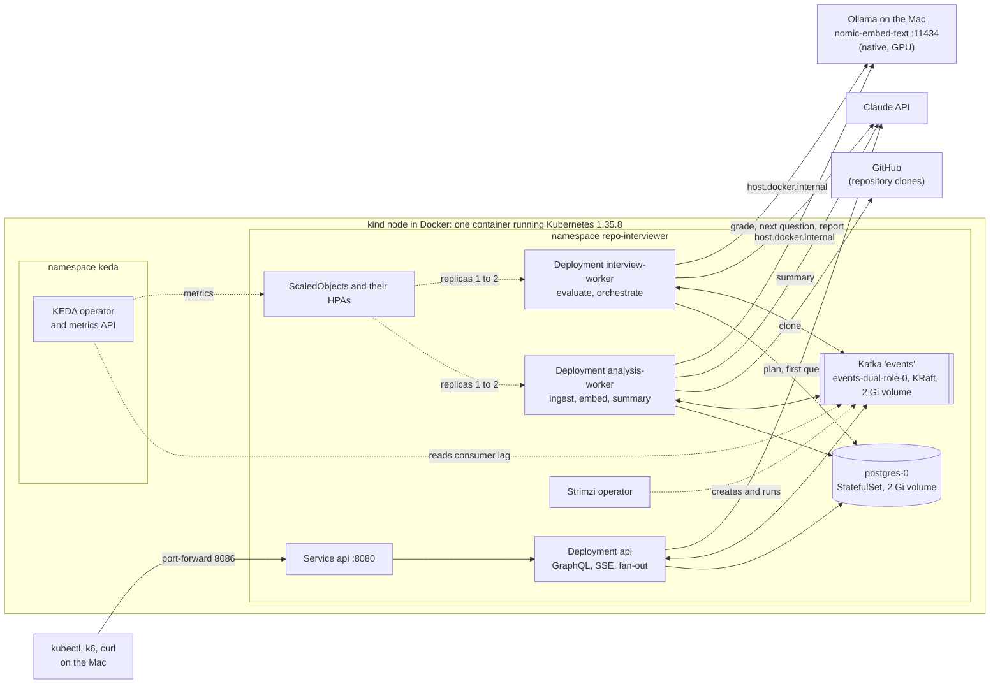

# Kubernetes (local, kind)

The whole app on a local Kubernetes cluster: Postgres with pgvector and Kafka run by the Strimzi operator (task 3.2),
the app as three Deployments of one image (task 3.3), and KEDA scaling the workers on Kafka consumer lag (task 3.4).
Design notes: `docs/LLD.md` §14; decisions D-022 to D-025 in `docs/DECISIONS.md`.



| Pod | What it runs | Consumer groups | Scaled |
|---|---|---|---|
| `api-…` | GraphQL, SSE subscriptions, `startInterview`, `submitAnswer` | `interview-events-<instance id>` (one per pod) | no, 1 |
| `analysis-worker-…` | clone and parse, embed, summary | `analysis-ingest`, `analysis-embed`, `analysis-summary` | KEDA, 1 to 2 (base: 5) |
| `interview-worker-…` | grading, next question, report | `interview-evaluate`, `interview-orchestrate` | KEDA, 1 to 2 (base: 5) |
| `postgres-0` | Postgres 17 + pgvector (StatefulSet) | | |
| `events-dual-role-0` | Kafka 4.2.2, KRaft controller and broker (Strimzi) | | |
| `strimzi-cluster-operator-…` | turns the `Kafka` and `KafkaNodePool` resources into pods, services, volumes | | |
| `keda-…` (namespace `keda`) | KEDA operator, metrics API server, admission webhook | | |

Inside the cluster: Postgres at `postgres:5432` (database `repo_interviewer`), Kafka at `events-kafka-bootstrap:9092`
(from another namespace: `events-kafka-bootstrap.repo-interviewer.svc:9092`).

```
k8s/
  kind-config.yaml        one-node cluster "repo-interviewer", Kubernetes 1.35.8 (pinned by digest)
  namespace/              the namespace "repo-interviewer", shared by strimzi/ and base/
  strimzi/                the Strimzi 1.3.1 operator (CRDs, RBAC, Deployment), from its pinned release file
  keda/                   KEDA 2.21.0, from its pinned release file
  base/                   portable: Postgres, Kafka, and app/ (ConfigMap, the three Deployments, the Service "api",
                          the workers' ScaledObjects)
  overlays/kind/          kind only: the dev database credentials, Ollama on the host, the local image, smaller JVMs,
                          at most 2 pods per worker
loadtest/                 the k6 load test and the replica sampler (task 3.4)
```

## Before you start

- Docker Desktop, [kind](https://kind.sigs.k8s.io/) 0.33.0 (`brew install kind`), kubectl 1.34 or newer, and for the
  load test [k6](https://k6.io) (`brew install k6`).
- **Disk:** about 8 GB free. Every image is stored twice, in Docker and inside the kind node, and Docker stops
  answering when the disk is full.
- **CPU:** turn off macOS Low Power Mode (System Settings → Battery). With it on, each app pod took 2 to 3 minutes to
  boot instead of 20 s, probes timed out and Kubernetes kept restarting pods. Stop other busy containers.
- **Memory:** everything uses about 3 GB of Docker's VM (3.8 GB on an 8 GB Mac). Stop the Compose stack while the
  cluster runs; its data stays:
  ```bash
  docker compose --profile kafka stop        # later: docker compose --profile kafka start
  ```
- **Ollama** runs natively on the Mac, not in the cluster (D-023); pods reach it at `http://host.docker.internal:11434`:
  ```bash
  brew services start ollama && ollama list  # must show nomic-embed-text
  ```
- **The API key** in `.env` (`ANTHROPIC_API_KEY=...`, see `.env.example`). The app makes real model calls.

## Set up from scratch

In this order: the two operators first (they add the `Kafka` and `ScaledObject` resource types), then the API key and
the app image, then one apply of everything else.

```bash
# 1. The cluster.
kind create cluster --config k8s/kind-config.yaml

# 2. The app image (Dockerfile, task 3.1). The first build downloads every dependency: several minutes.
docker build -t repo-interviewer:local .

# 3. Load the images into the node, so it does not download them again. One platform only: with Docker's
#    containerd image store, `kind load docker-image` fails on multi-platform images.
PLATFORM=$(docker version -f '{{.Server.Os}}/{{.Server.Arch}}')
for image in pgvector/pgvector:pg17 quay.io/strimzi/operator:1.3.1 quay.io/strimzi/kafka:1.3.1-kafka-4.2.2; do
  docker pull "$image"
done
for image in pgvector/pgvector:pg17 quay.io/strimzi/operator:1.3.1 quay.io/strimzi/kafka:1.3.1-kafka-4.2.2 \
    repo-interviewer:local; do
  docker save --platform "$PLATFORM" -o /tmp/kind-image.tar "$image"
  kind load image-archive --name repo-interviewer /tmp/kind-image.tar
done
rm /tmp/kind-image.tar

# 4. The operators. --server-side because their CRDs are too big for a client-side apply; use it for every apply
#    here, so one field manager owns the fields. Strimzi also creates the namespace.
kubectl apply --server-side -k k8s/strimzi
kubectl apply --server-side -k k8s/keda
kubectl -n repo-interviewer rollout status deployment/strimzi-cluster-operator --timeout=10m
kubectl -n keda rollout status deployment/keda-operator --timeout=10m

# 5. The API key, straight from .env into a Secret: never printed, never in a file in the repo.
kubectl -n repo-interviewer create secret generic anthropic \
  --from-env-file=<(grep '^ANTHROPIC_API_KEY=' .env)

# 6. Everything else: Postgres, Kafka, the app, the ScaledObjects.
kubectl apply --server-side -k k8s/overlays/kind
kubectl -n repo-interviewer wait pod -l app.kubernetes.io/name=postgres --for=condition=Ready --timeout=5m
kubectl -n repo-interviewer wait kafka/events --for=condition=Ready --timeout=10m
for role in api analysis-worker interview-worker; do
  kubectl -n repo-interviewer rollout status deployment/$role --timeout=8m
done
```

The app pods wait for Postgres and Kafka on their own: they are not Ready until the database answers (readiness
includes it), and the startup probe gives them 5 minutes to boot.

## Check

```bash
kubectl -n repo-interviewer get pods,pvc,scaledobject
# pod/analysis-worker-…            1/1   Running
# pod/api-…                        1/1   Running
# pod/events-dual-role-0           1/1   Running     Kafka
# pod/interview-worker-…           1/1   Running
# pod/postgres-0                   1/1   Running
# pod/strimzi-cluster-operator-…   1/1   Running
# persistentvolumeclaim/data-events-dual-role-0   Bound   2Gi
# persistentvolumeclaim/data-postgres-0           Bound   2Gi
# scaledobject/analysis-worker     MIN 1   MAX 2   READY True
# scaledobject/interview-worker    MIN 1   MAX 2   READY True

kubectl -n repo-interviewer exec postgres-0 -- psql -U ri -d repo_interviewer -c 'SELECT version()'
kubectl -n repo-interviewer exec events-dual-role-0 -- \
  bin/kafka-metadata-quorum.sh --bootstrap-server localhost:9092 describe --status
kubectl -n repo-interviewer exec events-dual-role-0 -- \
  curl -s -o /dev/null -w '%{http_code}\n' http://host.docker.internal:11434/api/tags   # 200: Ollama reachable
kubectl -n repo-interviewer logs deploy/interview-worker | grep 'partitions assigned'   # only its own groups
```

## Use it

The Service has no address outside the cluster; reach it through a port-forward:
```bash
kubectl -n repo-interviewer port-forward svc/api 8086:8080
curl localhost:8086/actuator/health/readiness        # {"status":"UP"}
# GraphQL at http://localhost:8086/graphql, GraphiQL at http://localhost:8086/graphiql (stage environment)
```
Answers are graded by the workers: `submitAnswer` returns at once with `evaluation: null`, and the grade and the
next question arrive on the `interviewEvents` subscription or by reading `interviewSession` again.

## Autoscaling and the load test

KEDA scales `analysis-worker` and `interview-worker` on their Kafka consumer lag (`k8s/base/app/scaling.yaml`): about
one pod per 2 waiting events, at least 1, at most 5 (2 in the kind overlay), never more than the topic's 3
partitions. KEDA keeps each worker at 1 or more, so `kubectl scale` on them is undone; scale the `api` instead.
```bash
kubectl -n repo-interviewer get scaledobject,hpa     # TARGETS 0/2 (avg) when idle
```

The load test uses the real model: about 10 calls per interview session and 1 per analysis, counted against the
daily cap (stage: 100), roughly $0.20 per session.
```bash
kubectl -n repo-interviewer port-forward svc/api 8086:8080 &
loadtest/sample-scaling.sh > scaling.log &           # lag, desired and ready replicas every 5 s
k6 run -e SESSIONS=7 loadtest/interviews.js
```
Result of one run, replicas going up under load and back down: `docs/RESULTS.md`, "Autoscaling with KEDA".

## Day to day

```bash
# A new app image: build, load (step 3 above, for repo-interviewer:local only), then restart the pods.
kubectl -n repo-interviewer rollout restart deployment/api deployment/analysis-worker deployment/interview-worker

# A changed manifest:
kubectl apply --server-side -k k8s/overlays/kind

# Stop: quitting Docker Desktop stops the cluster too, and starting Docker brings it back with its data.
# Remove it for good, with its data volumes:
kind delete cluster --name repo-interviewer
```

## Troubleshooting

Everything here happened while building it.

| Symptom | Cause | Fix |
|---|---|---|
| `docker` and `kubectl` hang, even `docker version` | the Mac's disk is full; Docker's disk image cannot grow | free space (`docker system df`, `docker builder prune`), then restart Docker Desktop |
| `connection refused` on `127.0.0.1:<port>` from kubectl | Docker Desktop is not running, so neither is the node | start Docker Desktop; the cluster comes back |
| pods take minutes to boot, probes fail, restarts climb | CPU starvation: Low Power Mode, or another busy container | Low Power Mode off; stop the other containers |
| Postgres "terminated by signal", pods not Ready | the VM ran out of memory | the kind overlay's smaller JVMs; stop Compose; give Docker more memory |
| `kind load docker-image`: "content digest … not found" | multi-platform image in Docker's containerd store | `docker save --platform …` and `kind load image-archive` (step 3) |
| `Apply failed with 1 conflict … kubectl-client-side-apply` | an earlier apply without `--server-side` | `kubectl apply --server-side --force-conflicts -k …` once |
| ScaledObject `READY False`, "lookup events-kafka-bootstrap … no such host" | KEDA runs in namespace `keda` | Kafka by its full name (already in `scaling.yaml`) |
| HPA lag shows nothing for a few seconds | Kafka is rebalancing a group, or the node is overloaded | nothing: the HPA keeps its last decision |
| Ollama answers 403 | it trusts only some Host headers while listening on 127.0.0.1 | use `http://host.docker.internal:11434`, not a Service alias (D-023) |
| `CreateContainerConfigError` on the app pods | the Secret `anthropic` is missing | step 5 |
