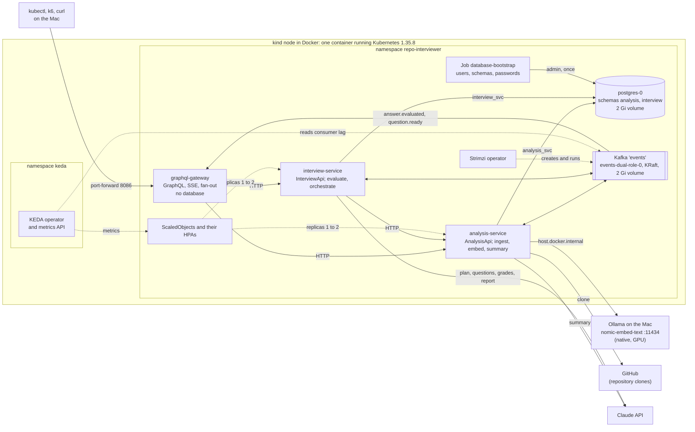

# Kubernetes (local, kind)

The three services on a local Kubernetes cluster: Postgres with pgvector and Kafka run by the Strimzi operator (task
3.2), `graphql-gateway`, `analysis-service` and `interview-service` as one Deployment and Service each (task 4.1; the
single app of task 3.3 until then), a Job that creates each service's database user, and KEDA scaling the two services
on their Kafka consumer lag (task 3.4). Design notes: `docs/LLD.md` §14; decisions D-022 to D-026 in
`docs/DECISIONS.md`.



| Pod | What it runs | Consumer groups | Scaled |
|---|---|---|---|
| `graphql-gateway-…` | GraphQL, SSE subscriptions; calls the two services over HTTP | `interview-events-<instance id>` (one per pod) | no, 1 |
| `analysis-service-…` | `AnalysisApi`; clone and parse, embed, summary | `analysis-ingest`, `analysis-embed`, `analysis-summary` | KEDA, 1 to 2 (base: 5) |
| `interview-service-…` | `InterviewApi`; grading, next question, report | `interview-evaluate`, `interview-orchestrate` | KEDA, 1 to 2 (base: 5) |
| `database-bootstrap-…` | once: both `db/bootstrap.sql`, then each service's password from its Secret; then `Completed` | | |
| `postgres-0` | Postgres 17 + pgvector (StatefulSet); schemas `analysis` and `interview`, one user each | | |
| `events-dual-role-0` | Kafka 4.2.2, KRaft controller and broker (Strimzi) | | |
| `strimzi-cluster-operator-…` | turns the `Kafka` and `KafkaNodePool` resources into pods, services, volumes | | |
| `keda-…` (namespace `keda`) | KEDA operator, metrics API server, admission webhook | | |

Inside the cluster: the services at `graphql-gateway:8080`, `analysis-service:8080` and `interview-service:8080`,
Postgres at `postgres:5432` (database `repo_interviewer`), Kafka at `events-kafka-bootstrap:9092` (from another
namespace: `events-kafka-bootstrap.repo-interviewer.svc:9092`).

```
k8s/
  kind-config.yaml        one-node cluster "repo-interviewer", Kubernetes 1.35.8 (pinned by digest)
  namespace/              the namespace "repo-interviewer", shared by strimzi/ and base/
  strimzi/                the Strimzi 1.3.1 operator (CRDs, RBAC, Deployment), from its pinned release file
  keda/                   KEDA 2.21.0, from its pinned release file
  base/                   portable: Postgres, Kafka, and services/ (the ConfigMap "app", the Job "database-bootstrap"
                          and its SQL from the services' own db/bootstrap.sql, one Deployment and Service per service,
                          the services' ScaledObjects)
  overlays/kind/          kind only: the dev database credentials (admin and one login per service), Ollama on the
                          host, the local images, smaller JVMs, at most 2 pods per service
loadtest/                 the k6 load test and the replica sampler (task 3.4)
```

## Before you start

- Docker Desktop, [kind](https://kind.sigs.k8s.io/) 0.33.0 (`brew install kind`), kubectl 1.34 or newer, and for the
  load test [k6](https://k6.io) (`brew install k6`).
- **Disk:** about 8 GB free. Every image is stored twice, in Docker and inside the kind node, and Docker stops
  answering when the disk is full.
- **CPU:** turn off macOS Low Power Mode (System Settings → Battery). With it on, each app pod took 2 to 3 minutes to
  boot instead of 20 s, probes timed out and Kubernetes kept restarting pods. Stop other busy containers.
- **Memory:** everything uses about 3 GB of Docker's VM (3.8 GB on an 8 GB Mac). Stop the Compose stack while the
  cluster runs; its data stays:
  ```bash
  docker compose --profile kafka stop        # later: docker compose --profile kafka start
  ```
- **Ollama** runs natively on the Mac, not in the cluster (D-023); pods reach it at `http://host.docker.internal:11434`:
  ```bash
  brew services start ollama && ollama list  # must show nomic-embed-text
  ```
- **The API key** in `.env` (`ANTHROPIC_API_KEY=...`, see `.env.example`). The services make real model calls.

## Set up from scratch

In this order: the two operators first (they add the `Kafka` and `ScaledObject` resource types), then the API key and
the three images, then one apply of everything else.

```bash
# 1. The cluster.
kind create cluster --config k8s/kind-config.yaml

# 2. The three images, one per service (Dockerfile, tasks 3.1 and 4.1). The first build downloads every dependency:
#    several minutes; then about 1.5 min (the gateway) to 3 min each. "${service}:local", with the braces: in zsh,
#    "$service:l..." is a modifier (lowercase) and would tag "graphql-gatewayocal".
for service in graphql-gateway analysis-service interview-service; do
  docker build --build-arg SERVICE=$service -t "${service}:local" .
done

# 3. Load the images into the node, so it does not download them again. One platform only: with Docker's
#    containerd image store, `kind load docker-image` fails on multi-platform images.
PLATFORM=$(docker version -f '{{.Server.Os}}/{{.Server.Arch}}')
for image in pgvector/pgvector:pg17 quay.io/strimzi/operator:1.3.1 quay.io/strimzi/kafka:1.3.1-kafka-4.2.2; do
  docker pull "$image"
done
for image in pgvector/pgvector:pg17 quay.io/strimzi/operator:1.3.1 quay.io/strimzi/kafka:1.3.1-kafka-4.2.2 \
    graphql-gateway:local analysis-service:local interview-service:local; do
  docker save --platform "$PLATFORM" -o /tmp/kind-image.tar "$image"
  kind load image-archive --name repo-interviewer /tmp/kind-image.tar
done
rm /tmp/kind-image.tar

# 4. The operators. --server-side because their CRDs are too big for a client-side apply; use it for every apply
#    here, so one field manager owns the fields. Strimzi also creates the namespace.
kubectl apply --server-side -k k8s/strimzi
kubectl apply --server-side -k k8s/keda
kubectl -n repo-interviewer rollout status deployment/strimzi-cluster-operator --timeout=10m
kubectl -n keda rollout status deployment/keda-operator --timeout=10m

# 5. The API key, straight from .env into a Secret: never printed, never in a file in the repo.
kubectl -n repo-interviewer create secret generic anthropic \
  --from-env-file=<(grep '^ANTHROPIC_API_KEY=' .env)

# 6. Everything else: Postgres, Kafka, the Job that creates the services' database users, the three services, the
#    ScaledObjects. The base reads the services' own db/bootstrap.sql from outside k8s/, which "kubectl apply -k"
#    refuses, so build it with the load restrictor off and apply the result. Since task 4.4 the overlay also makes
#    the Secret jwt-public-key from .dev-keys/jwt-public.pem: create your dev key pair first (README, "Tokens for
#    local use"), and the gateway accepts the tokens of java scripts/DevToken.java.
kubectl kustomize --load-restrictor LoadRestrictionsNone k8s/overlays/kind | kubectl apply --server-side -f -
kubectl -n repo-interviewer wait pod -l app.kubernetes.io/name=postgres --for=condition=Ready --timeout=5m
kubectl -n repo-interviewer wait kafka/events --for=condition=Ready --timeout=10m
kubectl -n repo-interviewer wait job/database-bootstrap --for=condition=Complete --timeout=5m
for service in analysis-service interview-service graphql-gateway; do
  kubectl -n repo-interviewer rollout status deployment/$service --timeout=8m
done
```

The pods wait on their own: each service's init container waits until its database login works (the Job may still be
creating it), the services are not Ready until their database answers, and the startup probe gives each 5 minutes to
boot. The three booted side by side in about 2.5 minutes on a laptop node (the gateway alone: 15 s).

## From the Phase 3 cluster (task 4.1)

A cluster set up before task 4.1 runs the single app as `api`, `analysis-worker` and `interview-worker`. Build and load
the three images (steps 2 and 3), remove the old objects, then apply (step 6). Postgres and Kafka keep their data, but
the services use new schemas: the projects and interviews of Phase 3 stay in `public`, unused (D-026).
```bash
kubectl -n repo-interviewer delete scaledobject analysis-worker interview-worker
kubectl -n repo-interviewer delete deployment api analysis-worker interview-worker
kubectl -n repo-interviewer delete service api
```

## Check

```bash
kubectl -n repo-interviewer get pods,pvc,scaledobject
# pod/analysis-service-…           1/1   Running
# pod/database-bootstrap-…         0/1   Completed   the users and schemas exist
# pod/events-dual-role-0           1/1   Running     Kafka
# pod/graphql-gateway-…            1/1   Running
# pod/interview-service-…          1/1   Running
# pod/postgres-0                   1/1   Running
# pod/strimzi-cluster-operator-…   1/1   Running
# persistentvolumeclaim/data-events-dual-role-0   Bound   2Gi
# persistentvolumeclaim/data-postgres-0           Bound   2Gi
# scaledobject/analysis-service    MIN 1   MAX 2   READY True
# scaledobject/interview-service   MIN 1   MAX 2   READY True

kubectl -n repo-interviewer logs job/database-bootstrap | tail -1               # analysis_svc and interview_svc are ready
kubectl -n repo-interviewer exec postgres-0 -- sh -c \
  "PGPASSWORD=interview_svc psql -h localhost -U interview_svc -d repo_interviewer -c 'SELECT 1 FROM analysis.project'"
# ERROR: permission denied for schema analysis       (each service sees only its own schema)

kubectl -n repo-interviewer exec postgres-0 -- psql -U ri -d repo_interviewer -c 'SELECT version()'
kubectl -n repo-interviewer exec events-dual-role-0 -- \
  bin/kafka-metadata-quorum.sh --bootstrap-server localhost:9092 describe --status
kubectl -n repo-interviewer exec events-dual-role-0 -- \
  curl -s -o /dev/null -w '%{http_code}\n' http://host.docker.internal:11434/api/tags   # 200: Ollama reachable
kubectl -n repo-interviewer logs deploy/interview-service | grep 'partitions assigned'  # only its own groups
```

## Use it

The gateway's Service has no address outside the cluster; reach it through a port-forward:
```bash
kubectl -n repo-interviewer port-forward svc/graphql-gateway 8086:8080
curl localhost:8086/actuator/health/readiness        # {"status":"UP"}
# GraphQL at http://localhost:8086/graphql, GraphiQL at http://localhost:8086/graphiql (stage environment)
```
Answers are graded by interview-service's workers: `submitAnswer` returns at once with `evaluation: null`, and the
grade and the next question arrive on the `interviewEvents` subscription or by reading `interviewSession` again.

## Autoscaling and the load test

KEDA scales `analysis-service` and `interview-service` on their workers' Kafka consumer lag
(`k8s/base/services/scaling.yaml`): about one pod per 2 waiting events, at least 1, at most 5 (2 in the kind overlay),
never more than the topic's 3 partitions; each new pod also serves its service's API. KEDA keeps each at 1 or more, so
`kubectl scale` on them is undone; scale `graphql-gateway` instead.
```bash
kubectl -n repo-interviewer get scaledobject,hpa     # TARGETS 0/2 (avg) when idle
```

The load test uses the real model: about 10 calls per interview session and 1 per analysis, counted against each
service's daily cap (stage: interview-service 80, analysis-service 20), roughly $0.20 per session.
```bash
kubectl -n repo-interviewer port-forward svc/graphql-gateway 8086:8080 &
loadtest/sample-scaling.sh > scaling.log &           # lag, desired and ready replicas every 5 s
k6 run -e SESSIONS=7 loadtest/interviews.js
```
Result of one run (Phase 3, the single app), replicas going up under load and back down: `docs/RESULTS.md`,
"Autoscaling with KEDA".

## Day to day

```bash
# A new image of one service: build it, load it (steps 2 and 3 above, for that image only), then restart it.
kubectl -n repo-interviewer rollout restart deployment/interview-service

# A changed manifest:
kubectl kustomize --load-restrictor LoadRestrictionsNone k8s/overlays/kind | kubectl apply --server-side -f -

# A changed db/bootstrap.sql or service password: a finished Job does not run again, and cannot be changed.
kubectl -n repo-interviewer delete job database-bootstrap   # then apply again (above)

# Stop: quitting Docker Desktop stops the cluster too, and starting Docker brings it back with its data.
# Remove it for good, with its data volumes:
kind delete cluster --name repo-interviewer
```

## Troubleshooting

Everything here happened while building it.

| Symptom | Cause | Fix |
|---|---|---|
| `docker` and `kubectl` hang, even `docker version` | the Mac's disk is full; Docker's disk image cannot grow | free space (`docker system df`, `docker builder prune`), then restart Docker Desktop |
| `connection refused` on `127.0.0.1:<port>` from kubectl | Docker Desktop is not running, so neither is the node | start Docker Desktop; the cluster comes back |
| pods take minutes to boot, probes fail, restarts climb | CPU starvation: Low Power Mode, or another busy container | Low Power Mode off; stop the other containers |
| Postgres "terminated by signal", pods not Ready | the VM ran out of memory | the kind overlay's smaller JVMs; stop Compose; give Docker more memory |
| `kind load docker-image`: "content digest … not found" | multi-platform image in Docker's containerd store | `docker save --platform …` and `kind load image-archive` (step 3) |
| `Apply failed with 1 conflict … kubectl-client-side-apply` | an earlier apply without `--server-side` | `kubectl apply --server-side --force-conflicts -k …` once |
| ScaledObject `READY False`, "lookup events-kafka-bootstrap … no such host" | KEDA runs in namespace `keda` | Kafka by its full name (already in `scaling.yaml`) |
| HPA lag shows nothing for a few seconds | Kafka is rebalancing a group, or the node is overloaded | nothing: the HPA keeps its last decision |
| Ollama answers 403 | it trusts only some Host headers while listening on 127.0.0.1 | use `http://host.docker.internal:11434`, not a Service alias (D-023) |
| `CreateContainerConfigError` on the service pods | the Secret `anthropic` is missing | step 5 |
| `kubectl apply -k`: "security; file … is not in or below …" | the base reads the services' `db/bootstrap.sql` from outside `k8s/` | build with `kubectl kustomize --load-restrictor LoadRestrictionsNone`, apply the output (step 6) |
| a service pod stays `Init:0/1`, its log says "waiting for analysis_svc" | the Job `database-bootstrap` has not run, or failed | `kubectl -n repo-interviewer logs job/database-bootstrap`; it retries on its own while Postgres starts |
| the image build fails: "Child module /build/… does not exist" | a module listed in the root `pom.xml` is not copied into the image | add its `pom.xml` to `.dockerignore` and the `Dockerfile` (as `system-test`, task 4.1) |
| images tagged `graphql-gatewayocal:latest` | zsh read `$service:l…` as a modifier | `"${service}:local"` (step 2) |
